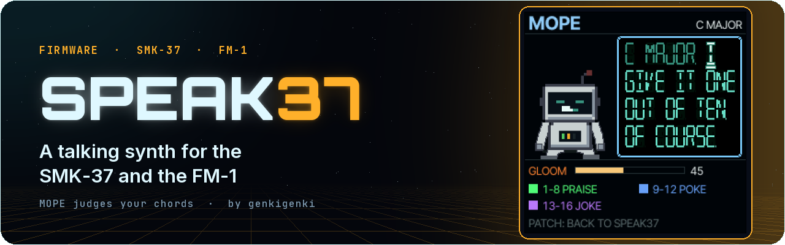
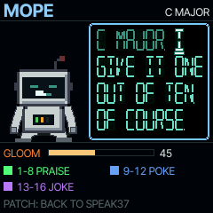
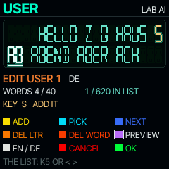
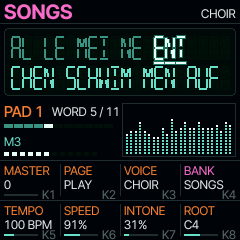

<p align="center"></p>

# Speak37

[](LICENSE)

**Watch it:** [Speak37 on YouTube](https://youtu.be/JkLWlMOAvNA) · **Install it:** <https://genkigenki.github.io/smk37/>

**Speech, played musically, on the M-Vave SMK-37 (SMK-37 Pro, Elite, MKE-P37) and the FM-1.** A speech synthesizer
in the style of the Speak & Spell: every key speaks the next word of a sentence, at the key's pitch. Pick a joke on
a pad and play it as a melody, a word a key; play a chord and the word comes out in harmony. Sing folk songs a word a key and the
Kyrie a syllable a key with a choir, chant robot mantras, play a beatbox kit, let PLAY speak a sentence in time over
a drum groove while the keys only choose its notes, write your own sentences on the instrument, or play to MOPE, a
gloomy robot that comments on what you play. Nine voices,
from the classic toy to a cold test-lab robot and a choir, delay, reverb, 16 drum grooves, and a green
vacuum-fluorescent display on the screen.

Speak37 runs on the keyboard's own chip, in place of the stock firmware. It is built on the platform layer of the
[Felucca](https://github.com/hugelton/Felucca) firmware (Leo Kuroshita / Hügelton Instruments): the hardware
drivers, USB, the flash store and the update path. RHYTHM plays an 808 from M-VAVE's FM1 Open (MIT), ported to
fixed point. Felucca's README is kept as
[README-UPSTREAM.md](README-UPSTREAM.md).

One-page reference: [CHEATSHEET.md](CHEATSHEET.md).

> **Version 1.0.** Installing custom firmware is at your own risk; the stock firmware can always be put back (see
> [Install](#install) and [Safety](#safety)).
>
> **FM-1: Need feedback how to improve the usage on the FM-1.** The FM-1 has no pads, faders or wheels, so their jobs
> sit on its buttons and knobs (see [On the FM-1](#on-the-fm-1)); ideas and reports are welcome.

## Quick start

1. Install Speak37 (see [Install](#install)).
2. The pads are the 16 sentences of a bank (SONGS at first, sung by CHOIR). Tap one: the display shows it.
3. Play the keys: each key speaks (or sings) the next word or syllable, at its pitch. After the last the first again.
   A sung word holds its vowel while the key is held and sings the rest when you let go.
4. Play a chord: keys pressed together speak the same word, in harmony.
5. Turn K3 (VOICE): CLASSIC, VINTAGE, DEEP, CHILD, WHISPER, ROBOT, LAB AI, GIANT, CHOIR. K4 (BANK) changes the bank
   (a bank with its own voice, such as ROBOT or LAB AI, picks it).
6. SEQ PLAY: the sentence speaks itself in time (TEMPO); now the keys only choose its pitch. SEQ PLAY again stops.
7. SEQ: the RHYTHM page, the pads are 16 drum grooves. Tap BOSSA NOVA, then SEQ PLAY: the words land on the beat.
8. The last bank, USER: hold a pad 0.6 s and write a sentence of your own.

## The sound

**An LPC speech engine in the style of the TI TMS5220** (the Speak & Spell's family of chips): an excitation (a
pulse train, the chip's own chirp, a glottal pulse or noise) through a ten-stage lattice filter whose reflection
coefficients K1..K10, energy and pitch come from the word's frames.

- **The words are our own.** No TI ROM vocabulary is used: every word of the sentences, the letters A..Z, the
  numbers and the editor's word lists are spoken by the free speech synthesizer
  [espeak-ng](https://github.com/espeak-ng/espeak-ng) (its own voice for each language) and LPC-encoded at build
  time by Speak37's own encoder (`tools/gen_vocab.py`) into TMS5220-style frames (the chip's quantisation tables for
  energy, pitch and K1..K10). The SMK-37 build holds 2759 words (390 KB of frames, 19 minutes of speech), the FM-1
  build 2576. The frames are 10 ms (the chip used 25 ms): measured with a speech recogniser, 25 ms frames lost about
  half of the words that 10 ms frames keep. Words are rendered a little faster and coded with a repeat tolerance,
  which keeps the recogniser's score at about 60 % of the bytes.
- **At the key's pitch.** The voiced frames' excitation runs at the key's note (with OCTAVE, pitch bend, vibrato,
  glide): within a cent of the key, every voice. The word's own intonation (its frames' pitch against its median)
  rides on top, 0..200 % (INTONE); unvoiced frames stay noise. A held key at the word's end holds its vowel (HOLD).
- **Formants** (FORMANT, LFO 2): the lattice runs at 8 kHz x 2^(FORMANT/12), so the whole vocal tract scales, a child
  up, a giant down; its output is resampled to 44.1 kHz, smoothly or held for the original's grit (LOFI).
  Held, its images (every formant mirrored around the lattice's rate: an open A's F1 and F2 came back at 7 kHz, only
  13 dB down, and an A sounded like an I) are taken away by a 4th-order low-pass at the lattice's band edge, as the
  Speak & Spell's own output filter did (now some 30 dB down); the vowels' F1 and F2 are as espeak-ng said them
  (`tests/sp_test.c` checks an open A's F1 above 600 Hz, an I's below 450 Hz).
- **Twelve voices at once** (CHOIR takes three a note; fewer if the processor runs short: it measures itself). See
  [CPU](#cpu).
- **Sung words** (SONGS, CHURCH, the language banks' songs): while its key is held the voice stays on the
  word's vowel at exactly the key's pitch, and letting go sings the rest. SONGS and the language banks' songs sing
  whole words, a word a key (clearer than syllables); CHURCH sings syllables (*E LE I SON*).
- **Speech percussion** (the PERCUSSION bank, KIT mode): BOOM, UH, B, P, D, T, K, KA, TS, TSS, TCH, SH, PF, POP,
  TOK, HA: espeak-ng's consonant sounds cut short with a decaying energy, brought up to the loud words. In KIT mode
  each key and each pad (by its pressure) plays one hit.

| Voice | Character |
|---|---|
| CLASSIC | the clear default: pulse excitation, a little grit, a gentle intonation |
| VINTAGE | the first Speak & Spell chips' chirp as excitation, held samples: the toy as remembered |
| DEEP | formants 3 semitones down, darker |
| CHILD | formants 4 up, livelier intonation, a bit faster |
| WHISPER | noise only, no pitch: every frame unvoiced |
| ROBOT | monotone (no intonation), a metallic comb tuned to the note |
| LAB AI | a cold, clean test-lab voice: a smooth glottal pulse, formants slightly up, its intonation snapped to semitone steps, a short glide between them |
| GIANT | formants 6 down, slower |
| CHOIR | every note sung by three voices, slightly detuned and apart in formants and time, a glottal pulse, a slow attack, a big room |

**Effects:** DELAY (DIGITAL, TAPE with wow and darkening repeats, PING-PONG), REVERB (damped combs and all-passes,
SIZE), SPREAD, TONE, METAL, BREATH, two LFOs (vibrato; the formants' wobble), the mod wheel's vibrato, pitch bend
(SETUP: 1..12 semitones), glide, envelope (ATTACK, RELEASE, velocity).

**Note modes** (HOLD; ARP cycles them): ONE SHOT (the word plays out), GATE (letting go fades it), HOLD (the word
plays out; held keys hold its vowel), LOOP (the word again and again while held).

## The sentences

Twenty banks of 16 sentences, then USER. Each line is said once (no line repeats itself: the sentence comes round
again by itself). The jokes, chants and robot lines are original text written for Speak37; the songs are
traditional or public-domain texts (their authors died more than 70 years ago).

| Bank | What |
|---|---|
| SONGS | folk songs, sung a word a key, German (sung by espeak-ng's German voice), English, French, Italian: *ALLE MEINE ENTCHEN*, *KOMMT EIN VOGEL GEFLOGEN*, *STILLE NACHT*, *TWINKLE TWINKLE LITTLE STAR*, *FRERE JACQUES*, *AMAZING GRACE* ... |
| CHURCH | Church Latin, sung: *KY RI E E LE I SON*, *GLO RI A IN EX CEL SIS DE O*, *A VE MA RI A*, *DO NA NO BIS PA CEM* ... |
| ROMANTIC | original sweet lines, a few in German (hot pink) |
| MANTRAS | robot chants: *BUILD-IT BREAK-IT FIX-IT SHIP-IT* (a hyphen joins words into one unit, one key) |
| PERCUSSION | beatbox lines, a hit a key: *BOOM TSS KA TSS* |
| DAD JOKES 1, 2 | *I couldn't figure out why the baseball kept getting larger. Then it hit me.* |
| CRINGE | original, family-friendly cringe (lime green) |
| ROBOT | a polite, sarcastic test robot (voice ROBOT) |
| LAB AI | a cold, passive-aggressive test-facility AI (voice LAB AI): *Thank you for volunteering. You did not volunteer.* |
| SPELLING | Speak & Spell style: *Spell cat. C A T. That is correct.*, the alphabet |
| NUMBERS | counting, a countdown, *The number zero has nothing to say.* |
| DEUTSCH, FRANCAIS, ESPANOL, ITALIANO, NEDERLANDS, SVENSKA | each in its own espeak-ng voice: the alphabet, one to ten, a traditional song sung a word a key, greetings, two or three original jokes, a romantic, a cringe and a robot line |
| ZHONGWEN, NIHONGO | Mandarin (shown in pinyin) and Japanese (shown in romaji), the same kinds of lines |
| USER | 16 sentences you write on the instrument (see [The editor](#the-editor-user)) |

A Portuguese bank was tried and left out: a speech recogniser that understood parts of espeak-ng's own Portuguese
recognised none of its words as Speak37 says them, word by word.

The text lives in [assets/speak/banks.txt](assets/speak/banks.txt): edit it, build, and the new words are spoken
and encoded (espeak-ng needed only for words not in the cache, `assets/speak/vocab_lpc.json`).

**Keys:** each key-down speaks the next word; keys within CHORD ms (SETUP, 40 ms) speak one word; REPEAT keeps the
same word; < > move the cursor; SEQ REC goes back to the first word. **LETTERS** (SCALE / FM-1 EDIT): the keys are
A..Z then ZERO..NINE from the lowest key. USB MIDI in plays the keys too (notes on any channel at their own pitch,
pitch bend, CC1, program change picks a sentence, the clock drives PLAY and RHYTHM).

## PLAY

SEQ PLAY (FM-1: PLAY) and the sentence speaks itself in time, word after word, round and round, a beat's rest at
its end: a word on the eighths (TEMPO, 40..240 BPM, on the PLAY page), a sung syllable a beat, a hit an eighth, a
long word as many eighths as it needs. The keys now only choose the pitch: the keys held (a chord: every word on all
its notes) set the word sounding and the ones after it; with none held the last notes stay (ROOT at the start).
Bend and the mod wheel still apply. The screen shows PLAY with its tempo and the bar's beats. SEQ PLAY again stops.
A USB MIDI clock, while one comes, sets the time (START and CONTINUE begin a bar).

## RHYTHM

A drum groove under the speech, played by an 808: the drum voices of M-VAVE's FM1 Open (its DaisySP / Plaits
adaptation, MIT) in a fixed-point port, `firmware/src/sp_808.c`: the kick's resonant body, the snare's shells and
noise, the clap's three pulses, the six-square hats and cymbal, the cowbell, a tom or a conga, a rim or a clave
(the groove picks). `tests/sp_808_test.c` compares every sound with FM1 Open's own float code, sample for sample.
`SP_808=0` builds the earlier kit, Felucca's drum voices. SEQ (SMK-37) opens the RHYTHM page: the pads
are 16 grooves, each lit in its colour, the one playing pulsing on the beat. A tap starts a groove (its tempo and
swing with it), the playing one again stops it, PARA rolls a fill into the next bar's last beat. The knobs: TEMPO,
DRUMS (the level), SWING, GROOVE. On the FM-1 the page is one of SELECT's, KNOB 4 picks the groove (OFF stops).

BOSSA NOVA, SAMBA, REGGAE DUB, DUB HOUSE, HOUSE, TECHNO, BOOM BAP, TRAP, DRUM AND BASS, FUNK, DISCO, ROCK, SHUFFLE
(triplets), WALTZ (3/4), AFROBEAT, ELECTRO.

The groove and PLAY share one tempo and one bar: one started while the other runs begins on the next bar, so the
words land on the beat. The drums are mixed dry after the speech's effects. They always play; when the processor
runs short the speech gives up voices first, then the drums their oldest ringing tails (down to 4 lanes).

## MOPE

PATCH (FM-1: EDIT held 0.6 s) switches MOPE on: Speak37 turns into a small, gloomy, sarcastic and rather well-read
grey-white robot that listens to what you play, tells you what it thinks of it, and sometimes plays something itself.
MOPE is a world of its own: while it is on, every knob, fader, wheel, button and pad only talks to MOPE and changes
nothing else (MASTER still sets the volume; OCT- and OCT+ held 5 s still the update mode). The keys play a soft
electric-piano tone. PATCH again (FM-1: EDIT held) and everything is as it was: the keys' mode, the page, SETUP, the
memories' page and the sound. MOPE is never stored: Speak37 always starts without it.

- **It listens** (pure rules, no learning): a phrase ends 1.3 s after the last key is let go. Notes sounding together
  are an interval (seconds to sevenths, the tritone, the octave), a chord by its pitch classes (major, minor,
  diminished, augmented, suspended, the five sevenths; the bass preferred as the root) or a cluster; notes one after
  another a scale up or down, a glissando, the same key again and again (counted), a single note, a tune; it hears how
  fast or slow, how loud or soft, the same thing again, and more than before. The header shows what it heard
  (C MAJOR, FIFTH ON C, G7, CLUSTER 5 ...).
- **It comments** after the phrase, never while a key is held, at least 3.5 s after its last line: each line is
  built fresh from the pools of [assets/speak/mope.txt](assets/speak/mope.txt) (openers, the observation's own lines or
  general templates, gloomy adjectives, asides such as NOT THAT ANYONE ASKED, sighs, closers by its mood), the slots
  filled with what you played (the chord, the interval, the note, the count); every pool avoids what it said lately
  and no line repeats one of the last eight. It says the line quickly in one go, loud and clear (its words some 10 dB
  above its music, still clean at full MASTER), in the ROBOT voice at 141 % on G3, dry and always in the centre (a
  speech recogniser finds it as clear as LAB AI, 36 % of its words against 37 %; a second voice on each word, in unison
  or an octave down, made it less clear), then answers with a short musical figure of its own in the key it heard.
- **Every control** gets its own lines: K1..K8, the four faders, the pitch and mod wheels, OCTAVE, SEQ PLAY, SEQ REC,
  SEQ, PARA, NOTE REPEAT, CHORD, ARP, FX, GLOBE, SCALE, < >, KNOB BANK / FADER BANK (on the FM-1 its knobs, SELECT and
  the page buttons, FX, GLO, ARP, SAVE, OCT, EDIT). A control is commented on once it has been left alone 0.8 s: its
  first touch always, later ones about every other time.
  Every touch also makes a little sound at once, quietly, so you hear the different world: a knob a soft OH or HMM up
  or down with its turn, a fader an OOH rising or falling, a wheel a bending OO, a button a P or T click (now and then
  a p-p-p stutter, a mumble, a sigh), a pad a blip; at most one every 0.22 s, never over its words. The wheels and
  faders count only a real movement: out of a dead band beyond their noise for 40 ms, the band following slow drift
  (so a resting mod wheel neither talks nor answers ASK).
- **Its activities** (a poke, now and then by itself, or for nobody when nothing is played):
  - LIGHTS: it lets a few little lights shine (the pads sparkle, the button LEDs blink) and asks if that made you happy;
  - DARK: it turns the light off (the screen black for 5 s) and finds that was not better either;
  - ASK: it asks for one control (turn that knob, move the mod wheel, press that button, a key, a pad); when you use
    that one it says it did not help, another one gets a gloomy remark, nothing in 15 s: you did not even try;
  - GAME: can you hit the moving light? A light wanders over the pads (FM-1: over its first 16 keys' lights); a wrong
    one hurts (OW, OUCH, THAT ONE HURT), a hit gets a grudging remark, three hits, 30 s or twelve misses and it gives up.
- **Its mood**: simple things (a fifth, an octave, a major triad, the same key, the same again) make it gloomier, rich
  ones (sevenths, diminished, augmented, a long varied tune) lift it a little, praise most. On the screen its head
  sinks and its antenna droops the gloomier it is, a cloud gathers, then rain; something rich makes it look up for a
  moment, its antenna's bulb flickering. Every press puts it in another pose, never the same twice in a row: slumped,
  one arm half raised, sitting, head in hands, lying flat, hunched, a shrug, kneeling. It moves like a puppet: its
  body and head drop on springs, each arm and leg two jointed segments that swing into the new pose, the forearms and
  shins lagging behind and settling (a little hop, a drop past the pose and back), its sighs and nods as smooth.
- **It sulks**: gloomy enough, it announces that it will play itself and plays a short sad piece, a new one each time:
  one of six minor progressions, one of three styles (a lament over a plucked bass, a waltz, rain: an eighth-note
  arpeggio), 56 .. 86 BPM, its own register, contour and rhythms. Any key stops it (OH. YOU ARE BACK.).
- **The pads** (SMK-37): the top row praises it (green), pads 9..12 poke it (blue), 13..16 ask for a joke (violet):
  original jokes about synthesizer players, told gloomily. FM-1: REC praises, PLAY pokes, SEQ a joke.
- **The screen**: always MOPE's while it is on. The robot on the left (pixel art: a boxy body, slumped shoulders, heavy
  lids over its eyes in a dark visor, its mouth turned down, three gloom lights on its chest; it blinks, sighs, its
  mouth's bars move while it talks, it nods to its own notes), on the right what it says in the display's
  sixteen-segment characters, black with a light-blue rim, the word being said lit; at the bottom its gloom, what it
  asked for or the game's pads, the pads' meaning and how to leave.
- **The console** (USB serial): `mope` lists its insides (its state, the keys it thinks are held, what is pending).

The lines are original text written for Speak37.



## The editor (USER)

The USER bank's pads start empty: LONG CLICK TO RECORD. Hold a USER pad 0.6 s (FM-1: REC held 0.6 s) and the editor
opens:

- the **keys** pick a letter, A..Z from the lowest key, and the list jumps to its first word beginning with it;
  two or three letters quickly one after the other jump to their prefix (E L: the first word with EL), a pause of
  a second starts anew (the screen shows TO EL...); **ADD** types the letter (it is said);
- the **word list** below the typed word shows the words of the language (EN or DE) that begin with it, K5 / < >
  scroll it (FM-1: KNOB 1, ARP / SEQ), **PICK** puts the word selected into the sentence;
- **NEXT** puts the word typed into the sentence: the vocabulary's word of that name, or, unknown, spelled letter by
  letter;
- **DEL LTR**, **DEL WORD**, **PREVIEW** (the sentence said), **EN / DE** (the list's language), **CANCEL** (red,
  nothing kept), **OK** (green: the sentence saved and SAVED said).

A word joining the sentence is said and glows. The pads are the editor's actions in their colours, and the legend
at the bottom of the screen says which is which (FM-1: REC ADD, HOME PICK, ENV NEXT, LFO DEL LTR, FX DEL WORD, PLAY
PREVIEW, EDIT EN / DE, GLO CANCEL, SAVE OK). The word lists are the most common English and German words (from
FrequencyWords, CC BY-SA 4.0): 684 + 640 on the SMK-37, 572 + 528 on the FM-1 (its app area is smaller; MOPE's words
came first); plus every
word of the banks by name.



## The screen

A Speak & Spell glass: two lines of 20 sixteen-segment ("starburst") characters in vacuum-fluorescent cyan-green.
The word spoken is near white, glowing and underlined, always on the first line (the sentence scrolls); the words
said are dimmer, the ones to come clearly readable; the unlit segments a faint ghost; a full stop is the character's
decimal point. The header shows the bank in its colour (each bank's name at least 4.5 : 1 against the background, a
test checks it) and the voice. Under the glass: the pad, WORD 5 / 14, the sentence's progress, the state (PLAY and
its tempo with the bar's beats, REPEAT, the octave), the voices sounding, and the **mouth**: the speaking voice's
filter as a spectrum. At the bottom the knob block, two rows of four in the knobs' order (SMK-37: K1..K8; FM-1: POT,
SEL, ALG, PRE and 1..4).



## Controls (SMK-37)

| Control | Function |
|---|---|
| K1 | MASTER (the volume) |
| K2 | PAGE: PLAY, VOICE, ENVELOPE, MOD, DELAY, SPACE, RHYTHM (also KNOB BANK / FADER BANK) |
| K3 | VOICE |
| K4 | BANK |
| K5..K8 | the page's four: PLAY (TEMPO, SPEED, INTONE, ROOT), VOICE (FORMANT, BREATH, LOFI, METAL), ENVELOPE (ATTACK, RELEASE, HOLD, GLIDE), MOD (VIB RATE, VIB DEPTH, WOB RATE, WOB DEPTH), DELAY (type, TIME, REPEATS, MIX), SPACE (REVERB, SIZE, SPREAD, TONE), RHYTHM (TEMPO, DRUMS, SWING, GROOVE) |
| Pads | the bank's 16 sentences: a sentence 10 %, the one in use 45 %, full while it speaks, in the bank's colour (USER: an empty pad faint white; held 0.6 s: the editor); RHYTHM: the grooves |
| PATCH | tap: MOPE on / off (see [MOPE](#mope)); held 0.6 s: the pads are the 16 memories (tap loads, hold 1 s saves) |
| < > | the word before / the next word |
| SEQ PLAY / SEQ REC | PLAY (the sentence in time) / back to the first word |
| SEQ | RHYTHM: the page, the pads the grooves (LED: a groove playing) |
| PARA | FILL |
| SCALE | the keys: SENTENCE, LETTERS, KIT |
| NOTE REPEAT | REPEAT: the same word every key |
| CHORD | CHORD on / off |
| ARP | HOLD: ONE SHOT, GATE, HOLD, LOOP |
| FX | the DELAY page, again SPACE |
| GLOBE | SETUP: K5 BEND, K6 CHORD, K7 VELO, K8 TRS OUT |
| OCTAVE- / + | the keys' octave; both held 5 s: the update mode |
| Faders | SPEED, FORMANT, DELAY's MIX, REVERB (each takes over once moved) |
| Wheels | pitch bend, vibrato |
| 3.5 mm jack | TRS MIDI OUT: the keys and wheels as played, channel 1 |

## On the FM-1

The same firmware for the FM-1 (`speak37-fm1-1.0.fwsc`, identity `FM-1_510`): MASTER the pot, SELECT the page (RHYTHM
among them: KNOB 4 the groove), ALGORITHM the voice, PRESETS the sentence (every pad of every bank in a row: B1 P1 ..
B21 P16), KNOB 1..4 the page's four. SAVE held 1 s saves the sound into the memory shown; SAVE + PRESETS picks a
memory. SEL / HOME / ENV / LFO / FX the pages, GLO SETUP, EDIT LETTERS, ARP / SEQ the word before / next, PLAY
PLAY, REC the first word (on a USER pad held 0.6 s: the editor), OCT- / OCT+ the octave. The 27 keys speak (no
velocity); in the editor they are A..Z from the lowest. EDIT held 0.6 s switches MOPE on and off; in MOPE REC
praises it, PLAY pokes it, SEQ asks for a joke, its light game runs over the first 16 keys' lights, and every other
button and knob only talks to MOPE.

**FM-1: Need feedback how to improve the usage on the FM-1.**

## Memories and the store

16 memories, each a whole sound (the voice, TEMPO and every knob, 27 bytes), and the sound in use, MASTER, the pad,
the settings and RHYTHM's DRUMS and SWING: one record ("SPK1", version 3; a record of version 1 or 2 keeps its sounds
and its pad moves to where its bank is now) in the keyboard's flash, two alternating copies with a check sum (a power
cut never loses both). The USER sentences have a record of their own ("SPU1": each word's index and a hash of its
text, and the vocabulary's hash: under another build's vocabulary each word is found again by its text, one no
longer there left out). On the SMK-37 both records live in the store's own window (FL_DATA: the settings 0xAD000 /
0xAE000, USER 0x9D000 / 0x9E000) and nowhere else: the stock controller mapping (USRFLASH) and the free area after it
are never touched. A store written by another firmware is cleared on first start (owner tag SPEAK37).

## Install

The packages of a release: `speak37-1.0.fwsc` (SMK-37 Pro, also the Starrykey 37 Play), `speak37-elite-1.0.fwsc`
(SMK-37 Elite), `speak37-mke-1.0.fwsc` (MKE-P37), `speak37-fm1-1.0.fwsc` (FM-1), with their `SHA256SUMS`.

**In the browser:** <https://genkigenki.github.io/smk37/> (Chrome or Edge: Web MIDI), connect the keyboard by USB and
follow the page.

**From the command line** (`pip3 install mido python-rtmidi`), the keyboard connected by USB:

```
python tools/fm1_install.py --yes speak37-1.0.fwsc          # SMK-37 Pro (also the Starrykey 37 Play)
python tools/fm1_install.py --yes speak37-elite-1.0.fwsc    # SMK-37 Elite (speak37-mke-1.0.fwsc: MKE-P37)
python tools/fm1_install.py --yes speak37-fm1-1.0.fwsc      # FM-1
```

The installer finds the keyboard by its port ("Speak37", in update mode "Speak37 Update"), checks the package's
identity against the device's model (an FM-1 package never goes to an SMK-37 and the other way round), resumes
only the Felucca family's own update loaders, and checks the identity after the restart.

**The way back to the stock firmware:** install M-Vave's own firmware for your model with M-Vave's updater (or with
`tools/fm1_install.py --force` and M-Vave's package). If Speak37 does not start, hold OCTAVE- and OCTAVE+ for 5 s
(FM-1: OCT- and OCT+) to enter the update mode, or power it on twice in a row with a crash in the first 30 s: it
then waits in the update mode for any installer.

## Safety

- The firmware never writes the keyboard's protected flash areas (the head, BTIF, USRTRIM, USRFLASH, the gap after
  it, USR, key_mac): an allow-list checked at compile time and a second net in the RAM flash driver; 4 KiB erases
  only. `tests/smk_flash_test.c` and `tests/sp_store_test.c` check every address, the USER record's too.
- OCTAVE- and OCTAVE+ held 5 s enter the update mode (UBOOT); two crashes in the first 30 s after power-on also do.
- A crash shows its whole record for 8 s.

## CPU

The audio runs in 32-sample blocks in the I2S interrupt. A voice's cost is mostly its resampler (each output sample)
and its lattice (only at the lattice's rate, 8 kHz x the formants' shift). From the target's own code
(`tests/sp_budget.py` on the pi32v2 listing): ~100 instructions a sample a voice at FORMANT 0 and ~210 at +12; the
bus (tone, delay, reverb) ~630. Twelve voices: ~1800 instructions a sample, ~120 MHz at 1.5 cycles an instruction,
half of the chip's slowest clock (240 MHz; units run at 320-360). The drums cost only while a voice rings: a dense
groove (TECHNO: kick, clap, both hats, rim) about six and a half speech voices' worth with the 808 (three and a half
with Felucca's kit, `SP_808=0`), all eight lanes ringing at once about twenty. Above 85 % load the firmware takes a
speech voice away (down to 3), then a ringing drum lane (down to 4, the oldest tail first), and gives them back
below 60 %, the lanes first. On a desktop host: ~50 ns a sample with 8 voices, 3.5 ns a voice, 22 ns the TECHNO
groove (12 with `SP_808=0`). MOPE's tones are 30 instructions a sample each (8 at most, ~240 for all of them, `mo_tone_run` in
`tests/sp_budget.py`'s listing): MOPE talking (one voice), eight tones and a dense groove at once come to about 1650
instructions a sample, ~110 MHz, under half of the slowest clock; on the host 1.5 ns a tone.

## Build

```
sh build.sh                                   # Felucca on the FM-1 (the host tests' reference build)
BOARD=smk37 sh build.sh [--model elite|mke]   # Speak37 on the SMK-37: build/speak37[-elite|-mke].fwsc
BOARD=fm1speak sh build.sh                    # Speak37 on the FM-1: build/speak37-fm1.fwsc
sh tests/run_tests.sh                         # after the FM-1 build: every host test
```

Linux / WSL with the JieLi toolchain and SDK, see [BUILDING.md](BUILDING.md). The words: `pip3 install
espeakng-loader numpy scipy` (only for words missing from the cache).

## Credits and licence

- [Felucca](https://github.com/hugelton/Felucca) by Leo Kuroshita / Hügelton Instruments, GPL-3.0-only: the
  platform (HAL, LCD and fonts, USB device mode, flash store, update path, the console's line editor) and, for
  `SP_808=0`, the drum voices (`firmware/src/drum_voice.c`, used as they are).
- RHYTHM's 808: the drum voices of [FM1 Open](https://github.com/m-vave/fm1_open) by M-VAVE (`third_party/synth/drum808.c`,
  their DaisySP / Plaits adaptation; Electrosmith, Corp, Emilie Gillet; MIT), ported to fixed point
  (`firmware/src/sp_808.c`, MIT; the originals in `third_party/fm1_open/`). Nothing else of FM1 Open is used.
- The LPC decoder is Speak37's own, after the structure of the TMS5220 as described by
  [Talkie](https://github.com/ArminJo/Talkie) (Peter Knight; Armin Joachimsmeyer's version; GPL-3.0) and MAME's
  tms5220 emulation; the chip's coding tables and the chirp are from MAME's `tms5110r.hxx` (BSD-3-Clause, Frank
  Palazzolo, Couriersud, Jonathan Gevaryahu).
- The words: [espeak-ng](https://github.com/espeak-ng/espeak-ng) (GPL-3.0-or-later) speaks them at build time; the
  encoder is Speak37's own. No TI vocabulary data is used.
- The editor's word lists: the most frequent words of
  [FrequencyWords](https://github.com/hermitdave/FrequencyWords) (Hermit Dave; content CC BY-SA 4.0, from the
  OpenSubtitles corpus), filtered (`tools/pick_words.py`), see [LICENSES](LICENSES/CC-BY-SA-4.0-FrequencyWords.txt).
- Speak37 (`firmware/src/sp_*.c`, `speak.c`, `tools/gen_vocab.py`, `tools/pick_words.py`, the sentences, MOPE's
  lines and jokes and the grooves): M. Geisler (genkigenki/makkuro).

Speak37 is licensed under the GNU General Public License v3.0 only (GPL-3.0-only), see [LICENSE](LICENSE) and
[LICENSING.md](LICENSING.md); the word lists in `assets/speak/words_*.txt` are CC BY-SA 4.0. Unofficial firmware,
not affiliated with or endorsed by M-Vave or Texas Instruments. "Speak & Spell" is a trademark of its owner, named
here only to describe the style.
